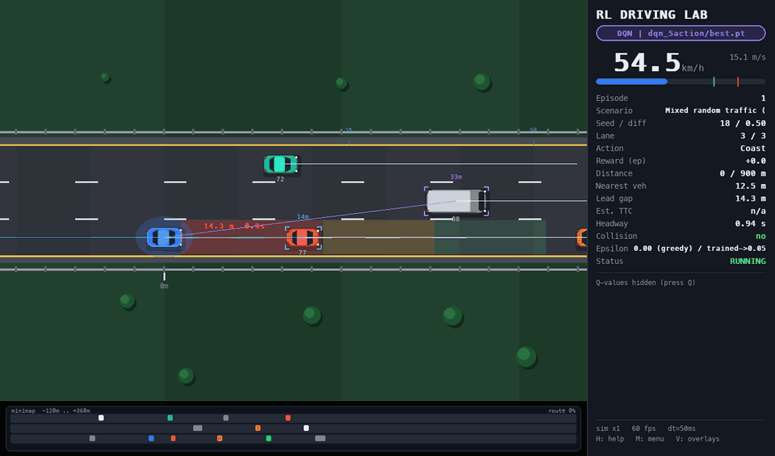
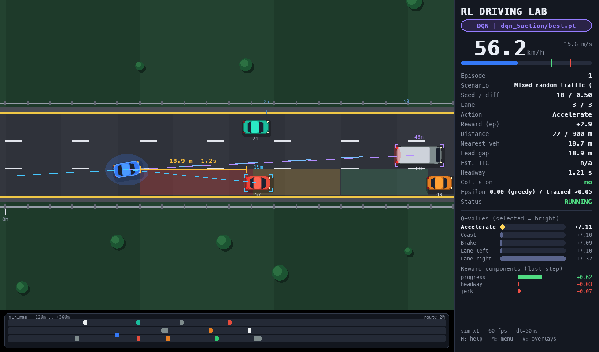
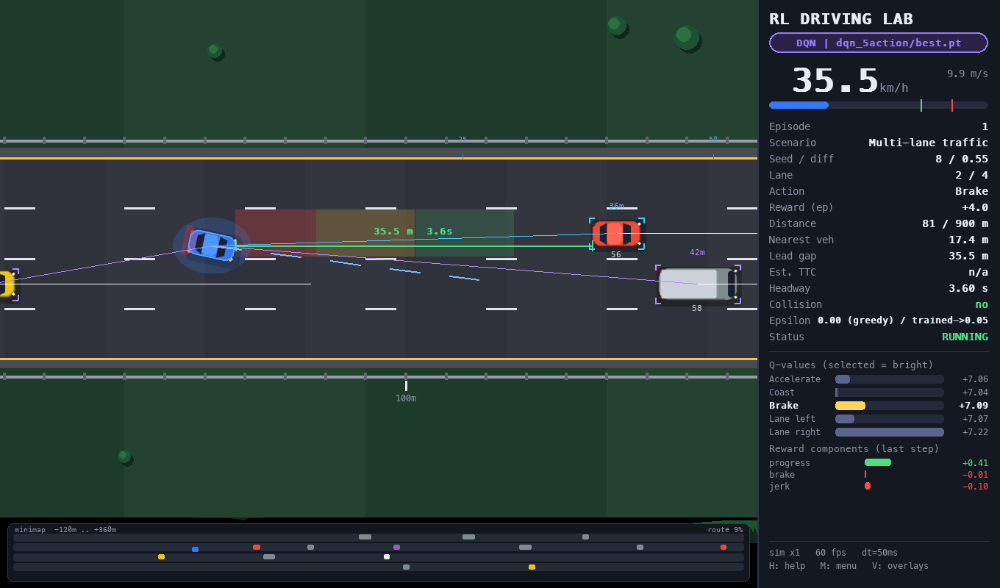
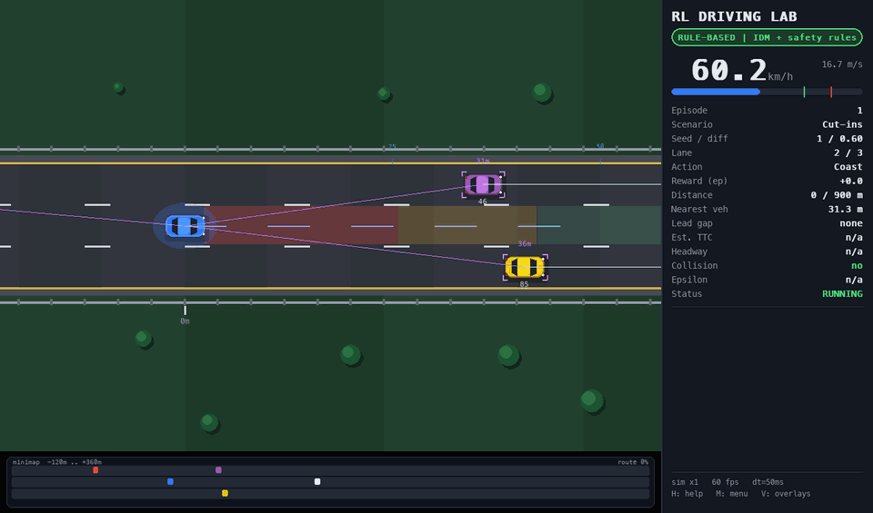
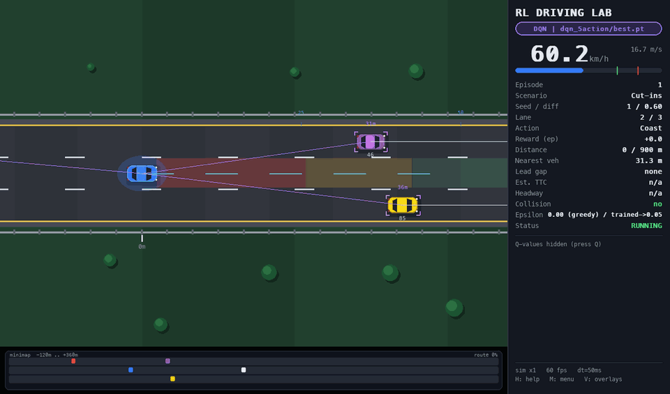
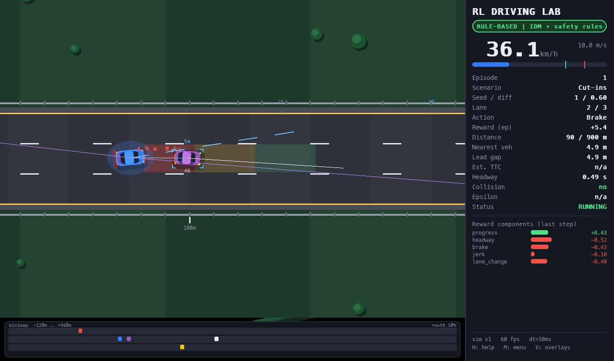
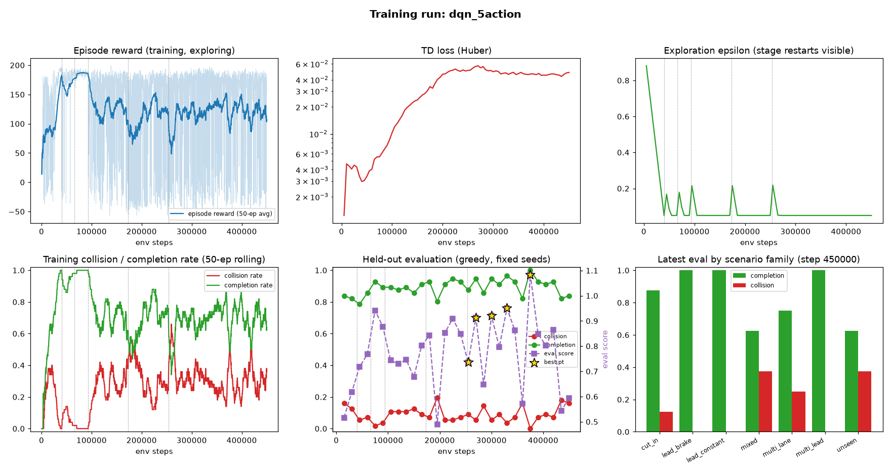
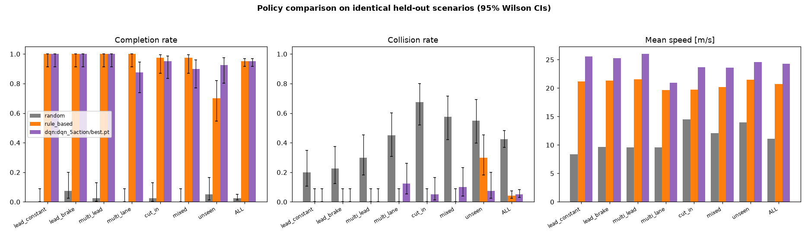
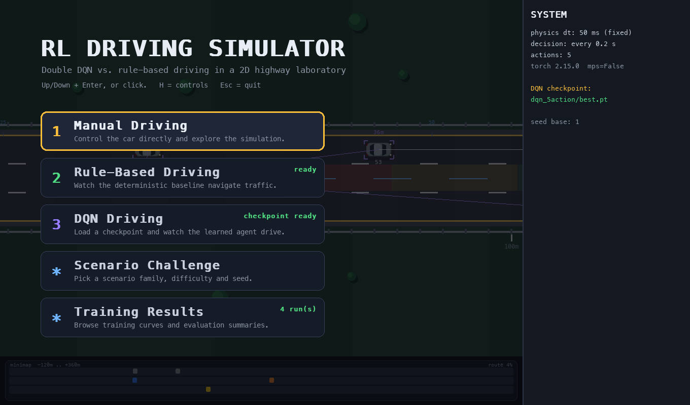

# RL Driving Simulator

A fixed-timestep 2D highway laboratory: jerk-limited longitudinal dynamics, continuous 3 s lane changes, swept-AABB collision, a 32-dimensional kinematic observation, and a Double DQN trained against a deterministic IDM baseline on paired, seed-disjoint scenarios. The observation carries only what a radar and ego odometry could measure.



Greedy playback (ε = 0) of `checkpoints/dqn_5action/best.pt` on `mixed` traffic, seed 18, difficulty 0.50. Twelve NPCs, three lanes. The network commits three lane changes inside this window. Physics advances at 50 ms and the sprite is interpolated between ticks, so the 3 s lateral move reads as a continuous trajectory. Sensor boxes, predicted paths, and the time-headway carpet are drawn from the same `Percepts` the policy receives.

```bash
python scripts/play.py --mode dqn --checkpoint checkpoints/dqn_5action/best.pt \
    --family mixed --seed 18 --difficulty 0.5
```

## One decision, full resolution



Same episode, t = 1.5 s. The right-hand panel is the decision the network just took.

The observation is 32 normalised floats (`OBS_VERSION = 2`, `OBS_NAMES` fixed). Ego block: speed, acceleration, lane position, lane-changing flag, lane existence, lane-change feasibility. Six neighbour slots (left / same / right × front / rear): presence, bumper gap, relative speed, with an absent vehicle encoded as presence 0 and a neutral gap so the MLP cannot confuse "nothing there" with "something far". Four time-to-collision channels, plus the lateral speed of the nearest front neighbour in each adjacent lane, a radar-measurable cut-in cue. `tests/test_observations.py` checks that scenario family, NPC behaviour, hidden brake timers, and future state never reach `build_observation`. It is a pure function of `Percepts`.

Reward is a sum of logged terms (`driving_sim/rewards.py`, weights in `configs/simulation.yaml`), one row per decision in `episodes.csv`:

| term | definition |
|---|---|
| progress | speed / 25 m/s, capped, so speeding past the target pays nothing |
| speed limit | linear penalty above 30 m/s |
| headway | squared shortfall below 1.5 s |
| TTC | squared shortfall below 4.0 s, only while closing |
| brake, jerk | excess deceleration above 3 m/s², and |Δa| against the 8 m/s³ jerk bound |
| lane change | −0.4, and −2.0 more if another starts inside a 25-decision cooldown |
| terminals | collision −50, off-road −50, stall −30, goal +25 |

On the frame above the lead is 18.9 m ahead at 1.21 s headway, inside the 1.5 s threshold, so the step pays a headway cost while progress stays positive. `Accelerate` wins the Q-vector. Below 0.5 m/s for 10 s the episode ends as `stalled`, so holding still is charged and then terminated.

## Lane change is a 3-second maneuver



`multi_lane`, seed 8, difficulty 0.55, t = 6.8 s. The ego is between lane centers. A lane change lasts 3.0 s and is rejected below 3 m/s or when `can_change_lane` fails; an illegal request is executed as coast and charged `invalid_action`. Longitudinal acceleration is jerk-limited at 8 m/s³, so brake and throttle cannot step. Collision tests use swept AABBs, so a vehicle that would tunnel through another inside one 50 ms tick still contacts. Traffic is IDM. Scripted cut-ins and braking events live in the scenario spec; the observation never receives them.

Four decisions per second: `dt = 0.05`, `decision_substeps = 4`, action held across the interval. Lane-change actions are applied on the first tick only.

## Same cut-in, two policies

| Rule-based IDM | Double DQN |
|---|---|
|  |  |

`cut_in`, seed 1, difficulty 0.60, both policies, same spec: a neighbour inserts from the left across a 31 m gap. The spec is a pure function of `(family, seed, difficulty)`, so the clip is reproducible from those three numbers. Both drivers consume the identical 32-D vector and the same action mask.



The still is the rule driver at t = 5.0 s: 4.9 m bumper gap, 0.49 s headway, braking from about 36 km/h. The last decision's reward breaks out as progress `+0.43`, headway `−0.52`, brake `−0.45`, jerk `−0.10`, lane change `−0.40`. The baseline is an IDM longitudinal law (`v0 = 24 m/s`, headway 1.6 s) discretised into accelerate / coast / brake, with a stopping-distance override and a lane change only when the adjacent gap is safe and the speed gain is real. It is deliberately strong. Matching it is the result that matters.

```bash
python scripts/play.py --mode rule --family cut_in --seed 1 --difficulty 0.6
python scripts/play.py --mode dqn --checkpoint checkpoints/dqn_5action/best.pt \
    --family cut_in --seed 1 --difficulty 0.6
```

## Double DQN

MLP 128–128 ReLU, online and target networks. The replay buffer stores the action mask so the max over the next state is taken only on legal actions. Loss is Huber (δ = 1), gradients clipped at 10, target synced every 1,000 updates. The bootstrap target is Double DQN,

`r + γ Q_target(s', argmax_a Q_online(s', a))`,

with γ = 0.99. Terminals cut the bootstrap; timeouts do not. ε decays linearly from 1.0 to 0.05 over 40,000 steps and is bumped to 0.25 at each curriculum boundary, then decayed again over 15,000 steps. Checkpoints store weights, Adam state, ε, step counters, RNG, config, `obs_dim`, `num_actions`, and `obs_version`. A mismatch raises `IncompatibleCheckpointError`. The 3-action and 5-action runs are separate networks and will not load into each other.

Training is headless and never imports pygame. Default device is CPU, which is faster for this MLP; `--device mps` selects the Apple GPU.

## Curriculum, then a held-out test



`configs/training.yaml`, 450,000 environment steps, seed 0. Six stages, and lane changes stay masked until stage 4 even though the action head is always width 5:

1. constant-speed lead
2. braking lead
3. multi-vehicle platoon
4. multi-lane, lane changes unmasked
5. cut-ins
6. mixed, which runs out the step budget

A stage advances when a trailing window clears a success and collision bar, or at `max_steps`. Earlier families stay in the mixture. Vertical lines on the reward, ε, and rate plots are those boundaries; the ε trace shows the restart at each one.

Seed discipline: training scenarios never use seeds in `[10_000_000, 30_000_000)`. Model selection evaluates on seeds from 10M (8 episodes per family, every 15,000 steps). The reported test uses seeds from 20M. The `unseen` family — different traffic mix and speeds — is never in the training distribution. `best.pt` is the best eval score **inside the final stage only**, so it has to be good on the full mixture. `last.pt` and `final.pt` are kept either way. This run's `best.pt` is the checkpoint at step 375,000.

## 280 paired scenarios



`scripts/evaluate.py`: 40 episodes × 7 families, difficulty spread over (0, 1), test seeds `20_000_000+`. Every policy drives the exact same list. DQN is greedy. Intervals are 95% Wilson. One training seed per model; run-to-run variance was not measured. Some tight cut-ins are physically unavoidable, so a residual collision rate is expected from every policy.

**5-action** (accelerate, coast, brake, lane left, lane right). `best.pt` at step 375k of 450k:

| policy | collision [95% CI] | completion [95% CI] | mean speed | unsafe / ep | hard brakes / ep | lane changes / ep | mean reward |
|---|---|---|---|---|---|---|---|
| random | 42.5% [36.8, 48.4] | 2.5% [1.2, 5.1] | 11.1 m/s | 0.58 | 3.31 | 8.91 | 5.6 |
| rule-based | 4.3% [2.5, 7.3] | 95.0% [91.8, 97.0] | 20.7 m/s | 0.19 | 0.79 | 0.97 | 184.9 |
| DQN | 5.0% [3.0, 8.2] | 95.0% [91.8, 97.0] | 24.2 m/s | 0.34 | 1.36 | 2.12 | 157.5 |

Collision and completion are statistically tied with the rule driver (paired completion splits 12–12). The network is faster, and it pays for that: more unsafe-following events, more hard brakes, more lane changes, and a lower return. Paired reward difference versus the rule driver is −27.4, bootstrap 95% CI [−34.9, −19.9]. The gap sits in `multi_lane` (12.5% collisions vs 0%, n = 40, intervals overlap) and `mixed` (10%). On `unseen`, which was held out of training, the network collides less (7.5% vs 30%). That per-family split is exploratory.

Against random, the same 280 scenarios: the DQN avoids 110 collisions random does not, and picks up 259 completions random misses. Paired reward difference +152.0, CI [+145.4, +158.2].

**3-action** (longitudinal only, 250k steps, `best.pt` at step 160k), same protocol, lane changes off for every policy:

| policy | collision [95% CI] | completion [95% CI] | mean speed | unsafe / ep | mean reward |
|---|---|---|---|---|---|
| random | 37.1% [31.7, 42.9] | 2.1% [1.0, 4.6] | 11.1 m/s | 0.49 | 16.3 |
| rule-based | 4.3% [2.5, 7.3] | 92.9% [89.2, 95.3] | 16.4 m/s | 0.20 | 180.0 |
| DQN | 1.8% [0.8, 4.1] | 95.4% [92.2, 97.3] | 16.0 m/s | 0.24 | 183.8 |

The 1.8% vs 4.3% collision difference sits inside the noise of this sample (paired reward difference +3.8, CI [−0.3, +8.5]). It concentrates in `unseen`.

Training-time eval is 8 episodes per family, so `best.pt` selection is noisy: the 5-action final-stage eval collision rate moved between about 5% and 16%. The tables above are the disjoint 20M-seed test.

## Run it



```bash
cd RL-Driving-Simulator
python3.13 -m venv .venv          # 3.10+ ; developed on 3.13 / Apple Silicon
source .venv/bin/activate
pip install -r requirements.txt
pip install -e .

python scripts/play.py                                   # menu
python scripts/play.py --mode manual
python scripts/play.py --mode rule --family cut_in --seed 7 --difficulty 0.8

python scripts/train.py                                  # 5-action, configs/training.yaml
python scripts/train.py --config configs/training_3action.yaml
python scripts/train.py --resume checkpoints/dqn_5action/last.pt --steps 600000

python scripts/evaluate.py --checkpoint checkpoints/dqn_5action/best.pt --name dqn_5action
python scripts/play.py --replay results/replays/<crash>.json
python -m pytest
```

DQN mode with no checkpoint says so and waits. `U` loads an untrained network, and the banner stays up for as long as those weights are driving.

| key | action |
|---|---|
| W / S, arrows | accelerate / brake (neither: coast) |
| A / D | lane left / right |
| Space | pause |
| R / N | restart this seed / next scenario |
| 1 / 2 / 3 | manual / rule-based / DQN |
| + / − | simulation speed |
| V | sensor, trajectory, and zone overlays |
| B | scrub the crash (after a collision) |
| K / U | cycle checkpoints / untrained network |
| H / M / Esc | help / menu / back |

A saved crash is the scenario spec plus the per-tick action trace. Replay re-simulates it and checks the outcome against the recording.

## What the test suite locks

`python -m pytest` (113 tests): braking distances, swept collision, lane-change boundaries, observation normalisation and the information barrier, reward components, Gymnasium `check_env`, deterministic resets, masked argmax, Double DQN targets, checkpoint compatibility and resume (optimiser state and counters), a short curriculum run that writes `best.pt` and the CSVs, headless paired evaluation, Wilson intervals, replay identity, and app smoke tests under the SDL dummy driver (menu, mode switch, crash scrub, missing checkpoint, FPS independence).

The numbers above are one training seed, no hyperparameter search, and no sensor noise. The rule driver and the DQN share the sensor, so the comparison is about the policy, on this kinematic model. The interactive window was exercised headlessly and by screenshot, not against a particular monitor's vsync path.
